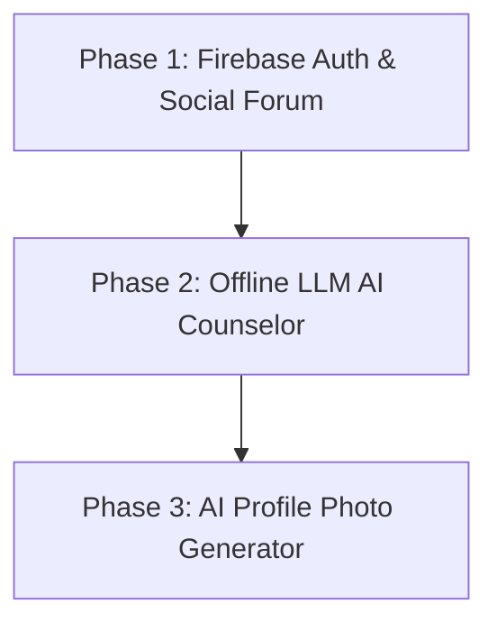
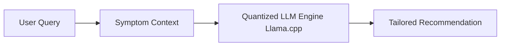

# Phase-by-Phase Technical Design & Implementation Plan

This document outlines the architecture, setup phases, and execution steps for transitioning the **thattimeofday** mobile wellness application into a social-enabled, glass-morphic platform with true offline AI integration and automated image generation.

---

## 🎨 Part 1: Liquid Glass Design System Spec

Classic glassmorphism concentrates on simulated depth, real-time light refraction, and metallic translucency. We combine our 4-color palette to achieve this look in Flutter.

### Color Token Mapping
*   **Background Base (`#FFF4BF`)**: Warm glass background tint. 
*   **Translucent Backdrop (`#FFBEFB` with Opacity)**: Liquid pink background fill for card surfaces.
*   **Primary Highlights (`#DC95FF`)**: Borders resembling soft refract Light highlights.
*   **Content Text & Shadow (`#8C56D4` / `#23143D`)**: Sleek contrasting structures for text styling and deep shadow layers.

### Flutter Implementation Primitive
To build a glassmorphic element, we layer `BackdropFilter` and borders:

```dart
Widget buildGlassCard({required Widget child}) {
  return ClipRRect(
    borderRadius: BorderRadius.circular(24),
    child: BackdropFilter(
      filter: ImageFilter.blur(sigmaX: 18.0, sigmaY: 18.0),
      child: Container(
        decoration: BoxDecoration(
          color: AppColors.cardBackground.withOpacity(0.35),
          borderRadius: BorderRadius.circular(24),
          border: Border.all(
            color: AppColors.primaryAccent.withOpacity(0.45),
            width: 1.5,
          ),
          boxShadow: [
            BoxShadow(
              color: AppColors.secondaryAccent.withOpacity(0.12),
              blurRadius: 16,
              offset: const Offset(0, 8),
            ),
          ],
        ),
        child: child,
      ),
    ),
  );
}
```

---

## 📅 Part 2: Phase-by-Phase Plan



### Phase 1: Firebase Auth & Social Forum Interface

Build a secure sign-up/login portal and a lightweight social forum featuring anonymous blogs, comments, likes, and global/direct chat rooms.

#### 1. Dependencies Configuration
Add packages to `pubspec.yaml`:
```yaml
dependencies:
  firebase_core: ^3.3.0
  firebase_auth: ^5.2.0
  cloud_firestore: ^5.3.0
```

#### 2. Firestore Document Database Schema

*   **Collection `/users`**:
    ```json
    {
      "uid": "USER_UNIQUE_ID",
      "display_name": "Nickname",
      "avatar_url": "https://storage.googleapis/.../avatar.png",
      "birth_date": "1998-06-15T00:00:00.000Z",
      "created_at": "2026-08-12T23:12:43.000Z"
    }
    ```
*   **Collection `/posts` (Social Forum Blogs)**:
    ```json
    {
      "post_id": "POST_AUTO_ID",
      "author_uid": "USER_UNIQUE_ID",
      "author_name": "Nickname",
      "author_avatar": "https://...",
      "content": "Tips to ease cramps during winter cycle days...",
      "created_at": "2026-08-12T23:14:00.000Z",
      "likes": ["UID_user1", "UID_user2"],
      "comments_count": 2
    }
    ```
*   **Subcollection `/posts/{post_id}/comments`**:
    ```json
    {
      "comment_id": "COMMENT_AUTO_ID",
      "author_uid": "USER_UNIQUE_ID",
      "author_name": "Nickname",
      "content": "Ginger tea and warm heating pads really help!",
      "created_at": "2026-08-12T23:15:00.000Z"
    }
    ```
*   **Collection `/chats` (Rooms)**:
    ```json
    {
      "room_id": "ROOM_AUTO_ID",
      "name": "Global Support Room / Ovulation Chat",
      "members": ["UID_user1", "UID_user2"],
      "last_message": "Anyone feeling bloated today?",
      "updated_at": "2026-08-12T23:16:00.000Z"
    }
    ```
*   **Subcollection `/chats/{room_id}/messages`**:
    ```json
    {
      "msg_id": "MSG_AUTO_ID",
      "sender_id": "USER_UNIQUE_ID",
      "sender_name": "Nickname",
      "text": "Anyone feeling bloated today?",
      "timestamp": "2026-08-12T23:16:00.000Z"
    }
    ```

#### 3. BLoC State Management
Implement `AuthBloc` (Login, Sign-Up, Sign-Out states), `ForumBloc` (FetchPosts, AddPost, LikePost, CommentPost states), and `ChatBloc` (StreamMessages, SendMessage).

---

### Phase 2: True Offline AI Chatbot (Modern LLM Setup)

Instead of rule-based logic, deploy a quantized Large Language Model (LLM) that runs directly on the user's mobile device GPU/CPU.

#### 1. Core Architecture


#### 2. Step-by-Step Training & Quantization
1.  **Model Selection**: Use **Llama-3.2-1B-Instruct** or **Gemma-2B-IT**. Both have low parameter counts and require under 1.2GB memory footprint in quantized states.
2.  **Dataset Construction**: Write a structured dataset containing ~5,000 conversational QA logs in Alpaca formatting:
    ```json
    {
      "instruction": "Provide wellness recommendations for a user in Luteal Phase experiencing cramps.",
      "input": "",
      "output": "During the luteal phase, cramps point to elevated prostaglandins. Focus on magnesium-rich foods like dark chocolate or pumpkin seeds, sip warm dandelion tea, and prioritize restorative stretching over strenuous exercises."
    }
    ```
3.  **Fine-Tuning (QLoRA)**: Fine-tune the model using HuggingFace Autotrain or Axolotl on a single T4 cloud GPU for ~3 epochs.
4.  **Quantization (GGUF/TFLite)**: Convert the PyTorch weights to GGUF format using `llama.cpp` and quantize it to 4-bit (`Q4_K_M`). This reduces size from 4.5GB down to ~850MB:
    ```bash
    python3 convert.py --outfile model.gguf ./my-fine-tuned-model/
    ./quantize model.gguf model_q4_k_m.gguf Q4_K_M
    ```

#### 3. On-Device Run Pipeline in Flutter
*   Use the Flutter plugin `sherpa_onnx` or integrate **ONNX Runtime** (`onnxruntime`), or embed **llama.cpp** inside the android/ios application build using **Flutter Rust Bridge (`flutter_rust_bridge`)** with a custom Rust binding library calling native `llama.cpp`.
*   Wrap loading procedures inside a splash page to import the 850MB `.gguf` file to on-device application storage.

---

### Phase 3: AI Profile Photo Generator

Generate branded, custom profile avatars using a serverless text-to-image API, keeping the client app lightweight.

#### 1. Core Architecture Pattern
```mermaid
sequenceDiagram
  ClientApp ->> Serverless API (Fal.ai/Replicate): POST /generate-avatar { prompt }
  Serverless API -->> Stable Diffusion XL + LoRA: Execute inference
  Stable Diffusion XL + LoRA -->> Serverless API: Return PNG Image
  Serverless API ->> Firebase Storage: Save PNG avatar file
  Firebase Storage ->> ClientApp: Show secure URL to user
```

#### 2. Image Conception & Style Fine-Tuning
*   **Vibe Definition**: Consistent wellness illustrations (e.g. minimalist line-art, pastel-tinted vectors, or neon glassmorphic avatars).
*   **Stable Diffusion training (LoRA)**: Collect 30-50 high-quality sample illustrations representing a unified art scheme. Train a custom LoRA on top of **Stable Diffusion XL (SDXL)** or **Flux.1-schnell** using Replicate or Fal.ai training scripts.
*   **Prompt Wrapper**: When the user requests an avatar generation (e.g., they input: "girl with curly hair"), wrap the prompt behind-the-scenes to maintain the correct visual identity:
    `"A minimalist line-art vector avatar of a girl with curly hair, pastel cream-pink glow background, s-style art theme, modern design."`

#### 3. API Execution & Cloud Storage
1.  Setup a FastAPI server on RunPod or call serverless Replicate endpoints.
2.  Provide an API route `/v1/generate-avatar` mapping payment tokens or onboarding details.
3.  Upload the raw bytes to **Firebase Cloud Storage**, and save the resulting image URL inside the user's Firestore profile document.
